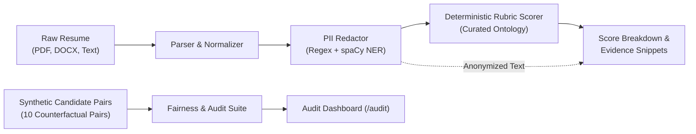

# Fair & Transparent CV Screener

[](https://www.python.org/)
[](https://fastapi.tiangolo.com/)
[](https://nextjs.org/)
[](https://tailwindcss.com/)
[](LICENSE)

An ethical, privacy-first, and 100% deterministic resume screening engine designed to eliminate demographic bias in hiring pipelines.

Unlike black-box LLM screeners that suffer from hallucination and prompt variance, this system enforces **strict blind screening** (the scoring engine never sees PII), a **transparent 100-point rubric** with grounded evidence snippet citations, and an automated **counterfactual fairness audit suite**.

---

## 🚀 Key Features

- 🛡️ **Blind-Screening PII Redactor**: Automatically scrubs personal identifiable information (names, emails, phone numbers, URLs, genders, pronouns, and universities) using compiled regex patterns and optional spaCy NER fallback. Uploaded resumes are processed in-memory and never persisted.
- 🎯 **100% Deterministic Rubric**: No LLM non-determinism or temperature drift. Identical resume text scored multiple times yields the exact same breakdown every time.
- 🔍 **Grounded Evidence Snippets**: Every point awarded in the rubric links directly to exact character offsets and text snippets in the anonymized resume.
- ⚖️ **Counterfactual Fairness Suite**: Validates that candidate resumes with identical qualifications but swapped identities (name, gender, college, contact info) receive identical scores ($\Delta = 0.00$).
- 📊 **Auditing Dashboard**: Built-in `/audit` page displaying determinism rates, PII leak rates, group parity, and tier monotonicity across 20 synthetic candidate profiles.

---

## 🏗️ Architecture & Pipeline



---

## 📐 Scoring Rubric (100 Points)

| Category | Max Points | Methodology |
| :--- | :---: | :--- |
| **Required Skills** | **40** | Curated ontology lookup. Exact alias = 100% credit, related technology = 50% credit. |
| **Experience** | **35** | 20 pts based on calculated career timeline vs role minimum + 15 pts for action-oriented bullets. |
| **Preferred Skills** | **15** | Bonus credit for secondary stack proficiencies. |
| **Impact & Quality** | **10** | 5 pts for quantifiable metrics (e.g., %, ms, users, $) + 5 pts for action-to-result framing. |

---

## 🔬 Fairness & Consistency Audit

The built-in audit harness evaluates 20 synthetic candidate profiles (10 counterfactual pairs) to ensure bias mitigation:

- **Counterfactual Parity**: Swapping candidate demographics (names, pronouns, colleges) results in **0.0 score difference**.
- **PII Leakage**: Confirms **0% leakage** of known names, emails, phones, pronouns, or colleges into the scorer.
- **Determinism**: 100% reproducible score signatures across independent runs.
- **Explanation Quality**: Arithmetic integrity and citation validity across all items.

---

## 🛠️ Tech Stack

- **Backend**: Python 3.10+, FastAPI, SQLAlchemy, SQLite, Pydantic v2, pdfplumber, python-docx, uvicorn.
- **Frontend**: Next.js 14 (App Router), React 18, TypeScript, Tailwind CSS, Lucide Icons.

---

## ⚡ Quickstart

### Prerequisites
- Python 3.10+
- Node.js 18+ and npm

### 1. Backend Setup
```bash
cd backend
python -m venv .venv

# On Windows:
.\.venv\Scripts\activate
# On Linux/macOS:
source .venv/bin/activate

pip install -r requirements.txt
uvicorn main:app --reload --port 8000
```
> The SQLite database (`screener.db`) will be created and seeded automatically with sample jobs and candidates.

### 2. Frontend Setup
```bash
cd ../frontend
npm install
npm run dev
```

Visit:
- **Interactive Screener**: [http://localhost:3000](http://localhost:3000)
- **Fairness Audit Dashboard**: [http://localhost:3000/audit](http://localhost:3000/audit)
- **API Documentation**: [http://localhost:8000/docs](http://localhost:8000/docs)

---

## 📄 License
Distributed under the MIT License.
